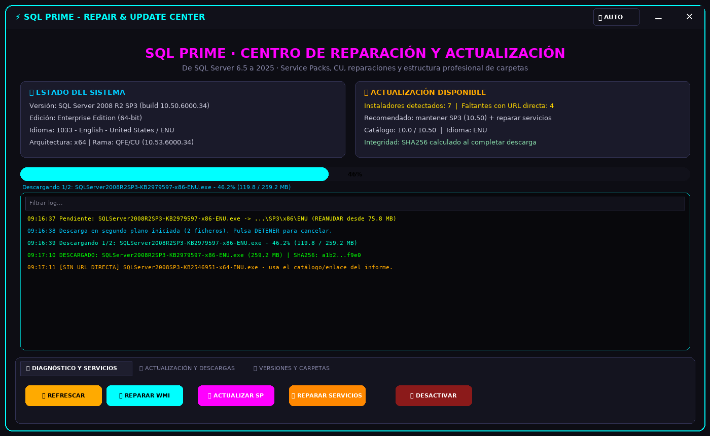

<div align="center">

# ⚡ SQL PRIME

**Centro profesional de diagnóstico, reparación y actualización para SQL Server**

[](#-requisitos)
[](#-requisitos)
[](#-características)
[](#-seguridad)
[](docs/ROADMAP.md)

<br/>



<br/>

<sub>SQL PRIME · Diagnostica. Repara. Actualiza.</sub>

</div>

---

## 📌 Descripción

**SQL PRIME** es una herramienta de escritorio para Windows, construida en **PowerShell + WPF**, orientada a administradores y técnicos que necesitan **diagnosticar, reparar y actualizar** entornos SQL Server con trazabilidad y controles de seguridad.

El proyecto cubre flujos críticos como detección de instancia, inventario de instaladores, descargas con reanudación, verificación de integridad, reparación de servicios/WMI y generación de reportes.

> **Alcance actual:** enfocado principalmente en SQL Server 2008 / 2008 R2, con catálogo y estructura multiversión en evolución.

---

## ✨ Características

| Área | Capacidad | Estado |
|---|---|---|
| Diagnóstico | Detección de instancia, versión, edición, LCID/idioma, arquitectura y rama | ✅ |
| Inventario | Escaneo de instaladores, clasificación por SP/KB/arch/idioma, reporte de faltantes | ✅ |
| Descargas | Descarga con reanudación `.part`, progreso por archivo (%/MB), cola de pendientes | ✅ |
| Integridad | Cálculo SHA256 al completar descarga; verificación contra hash esperado cuando existe | ✅ Fase 0 |
| Logging | Log UI + log estructurado JSONL con rotación (`logs/sql_prime.jsonl`) | ✅ Fase 0 |
| Reparación | Reparación WMI, servicios SQL, flujos guiados de recuperación | ✅ |
| Seguridad operativa | Confirmaciones para acciones críticas, modo simulación, auditoría local | ✅/En progreso |
| Catálogo | Definiciones de SP/KB, URLs directas/catálogo, base versionada `catalog/catalog.json` | ✅ |
| UI/HUD | Barras de progreso con degradado neón (cian → violeta → magenta), glow y marco reactivo por estado en Dark/Light | ✅ |
| Reportes | Reporte de cobertura y de servicios con KPIs, mini-barras por fila y barras futuristas animadas | ✅ |

---

## 🔒 Seguridad

SQL PRIME trata las operaciones de sistema como **sensibles por defecto**:

- **Integridad de descargas**: calcula SHA-256 al finalizar cada descarga y lo registra. Si existe un hash esperado en el catálogo, valida la coincidencia; si no coincide, la descarga se marca como fallida.
- **Catálogo versionado**: `catalog/catalog.json` con `schemaVersion`, tamaños esperados y campo `sha256` (sin hashes inventados; `null` hasta verificación oficial).
- **Logging estructurado**: eventos JSONL con nivel, componente, timestamp y datos de operación para auditoría local.
- **Privilegios mínimos**: las acciones administrativas deben ejecutarse con permisos elevados solo cuando son necesarias.
- **Sin secretos en repositorio**: no se deben versionar credenciales, llaves, certificados privados ni datos sensibles. `.gitignore` excluye artefactos/logs locales.
- **Transparencia**: las acciones destructivas/críticas deben mostrar confirmación y resultado verificable.

> Recomendación: ejecutar el script desde una ruta confiable, revisar el código antes de elevar privilegios y validar hashes oficiales antes de usar instaladores en producción.

---

## 🧭 Arquitectura (Fase 0)

```text
SQL_PRIME/
├── Fix_Error-0x800706be.ps1      # App principal WPF (UI + flujos)
├── SQL_PRIME_Enhancements.ps1    # Mejoras avanzadas (A-H)
├── modules/                      # Módulos Fase 0 (Core)
│   ├── Config.ps1                # Config versionada y defaults
│   ├── Logging.ps1               # JSONL estructurado + rotación
│   ├── Integrity.ps1             # SHA256 y verificación
│   ├── ErrorHandling.ps1         # operationId y errores estándar
│   ├── Authenticode.ps1          # Verificación de firma
│   └── Catalog.ps1               # Definiciones SP/KB/URLs/tamaños
├── config/
│   └── app.config.json           # Config base (schemaVersion)
├── catalog/
│   └── catalog.json              # Catálogo de instaladores (hash/size/url)
├── scripts/                      # Utilidades (hashes, tests, mantenimiento)
├── tests/                        # Tests Pester
├── docs/
│   ├── ROADMAP.md                # Roadmap por fases
│   └── assets/                   # Capturas para README/web
├── Instaladores/                 # Carpetas por versión SQL Server
│   ├── SQL Server 2008 (10.0)/   # Estructura por SP/CU/arch/lang
│   ├── SQL Server 2008 R2 (10.50)/
│   └── ...                       # 6.5 -> 2025
└── logs/                         # Generado en runtime (ignorado)
```

---

## ✅ Requisitos

- **OS**: Windows 10/11 o Windows Server compatible.
- **PowerShell**: 5.1+ (recomendado) o PowerShell 7+ donde aplique.
- **Permisos**: Administrador para reparaciones, servicios, registro o instalación de SP/CU.
- **Red**: acceso a URLs oficiales de Microsoft para descargas (cuando aplique).
- **.NET/WPF**: disponible en entornos Windows estándar para la UI WPF.

---

## 🚀 Uso rápido

1. Clona o descarga el repositorio.
2. Abre PowerShell como **Administrador** (recomendado).
3. Ejecuta la herramienta principal:

```powershell
Set-ExecutionPolicy -Scope Process -ExecutionPolicy Bypass
.\Fix_Error-0x800706be.ps1
```

4. Flujo sugerido:
   - **Refrescar estado** → detectar instancia e idioma.
   - **Inventario / Descargas** → revisar faltantes y rutas.
   - **Descargar faltantes** → obtener instaladores con reanudación y SHA256.
   - **Reparar servicios / WMI** → aplicar correcciones guiadas.
   - **Actualizar SP** → solo con paquete correcto (idioma/arquitectura/rama).

---

## 📦 Integridad de descargas

| Control | Detalle |
|---|---|
| Reanudación | `.part` + `Range`/HTTP 206 cuando el servidor lo soporta |
| Tamaño esperado | Validación contra tamaño conocido cuando existe |
| SHA256 | Se calcula siempre al completar; se valida si `catalog/catalog.json` tiene hash |
| Resultado | OK / FALLA con motivo en UI y log estructurado |

---

## 🎛️ Indicadores futuristas

La experiencia visual se unificó en las cuatro superficies donde el usuario sigue una operación:

| Superficie | Indicador | Detalle |
|---|---|---|
| Ventana principal | Barra global de descarga/reparación | Relleno `LinearGradientBrush` cian `#00F5FF` → violeta `#7C4DFF` → magenta `#FF3DFF`, brillo superior y glow; porcentaje centrado con sombra para legibilidad |
| Modal de servicios | Barra por operación + marco semántico | El borde adopta el color del paso (éxito, aviso, error) y mantiene ETA/contador/cronómetro |
| Reporte HTML | KPIs + mini-barras | Cobertura de inventario, hashes SHA-256 y salud por instalador; animación *sheen* que respeta `prefers-reduced-motion` |
| Informe de servicios | Antes/Después | Barras de servicios activos y continuidad, además de la barra por snapshot |

Los colores del degradado se ajustan desde `Apply-Theme` (`Fix_Error-0x800706be.ps1`), por lo que el tema claro mantiene contraste con una paleta azul/índigo/fucsia sin perder el estilo HUD.

---

## 🧭 Mejora continua (P0/P1 aplicado)

- **Design system**: tokens centralizados en `config/design-system.json`, consumidos por la UI y los reportes.
- **Telemetría local**: `scripts/New-SQLPrimeTelemetryDashboard.ps1` genera un dashboard con sparklines SVG a partir de `logs/sql_prime.jsonl` (sin enviar datos a ningún servicio).
- **Dry-run**: al activar `SIMULACIÓN` se genera automáticamente un HTML con el diff planeado (estado actual → acción) y la instrucción de rollback por servicio.
- **Calidad**: nuevos tests de integración cubren reanudación `.part`, final incompleto, tamaño desconocido e inventario previo.
- **PDF**: `scripts/Export-SQLPrimePdf.ps1` convierte cualquier reporte HTML a PDF con Edge headless, sin dependencias externas.

El backlog completo y los próximos aspectos a superar están en [`docs/CONTINUOUS_IMPROVEMENT.md`](docs/CONTINUOUS_IMPROVEMENT.md).

La propuesta para llevar toda la experiencia a la Web (arquitectura híbrida con agente local, API, SignalR, seguridad y fases) está en [`docs/WEB_MIGRATION_PROPOSAL.md`](docs/WEB_MIGRATION_PROPOSAL.md).

---

## 🗺️ Roadmap

El roadmap vivo está en [`docs/ROADMAP.md`](docs/ROADMAP.md).

- **Fase 0 (en progreso)**: fundamentos, config versionada, logging JSONL, integridad SHA256.
- **Fase 1**: UX premium, centro de descargas avanzado, wizard guiado.
- **Fase 2**: hardening de seguridad, playbooks SQL, reportes antes/después.
- **Fase 3**: empaquetado firmado, auto-update, CI/CD Windows.
- **Fase 4**: evolución a **.NET 8/C#** + componente web/API con **TLS 1.3 y ECC (ECDSA P-256/P-384, ECDHE)**.

---

## 🌐 Sincronización Web / Repositorio

Cada vez que se realicen cambios relevantes en la app, se debe actualizar también la presencia del repositorio:

- [ ] `README.md` (capturas, características, estado real)
- [ ] `docs/ROADMAP.md` (fase/progreso)
- [ ] `docs/assets/` (capturas actualizadas)
- [ ] **About** del repositorio: descripción, topics y web/homepage
- [ ] Release notes / changelog cuando aplique

**About recomendado (GitHub):**
- **Description**: `SQL PRIME: herramienta profesional en PowerShell/WPF para diagnosticar, reparar, actualizar y gestionar instaladores de SQL Server (2008/2008 R2 y catálogo multiversión).`
- **Topics**: `powershell`, `wpf`, `sql-server`, `windows`, `sqlserver`, `database-tools`, `sysadmin`, `repair-tool`

---

## 🤝 Contribución

1. Crear rama desde `main`.
2. Hacer cambios pequeños y trazables.
3. Actualizar README/docs si cambia comportamiento o UI.
4. Incluir evidencia (captura/log) en el PR.
5. No incluir secretos, instaladores binarios ni datos sensibles.

---

## ⚠️ Aviso

Esta herramienta realiza operaciones sensibles sobre servicios, registro y componentes de SQL Server. Úsala bajo tu responsabilidad, con respaldos y en ventanas de mantenimiento cuando corresponda. Los instaladores y marcas pertenecen a sus respectivos propietarios (Microsoft).
