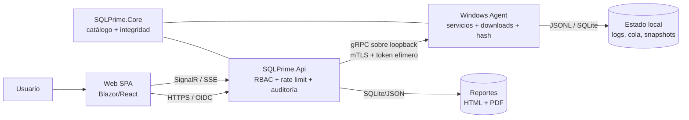

# SQL PRIME — Propuesta completa de migración a Web

> Objetivo: que la experiencia Web tenga **paridad funcional** con `Fix_Error-0x800706be.ps1` y supere la versión WPF en profesionalidad, sin perder las capacidades locales privilegiadas (servicios, descargas, hashes, snapshots).

---

## 1. Principio rector

El navegador **no puede** detener servicios de Windows, escribir en `Program Files` ni reanudar una descarga con `Range` directamente. Por tanto, la Web será la **capa de orquestación y visualización**, y un **agente local con privilegios mínimos** ejecutará las operaciones.

| Capa | Responsabilidad | ¿Se expone a Internet? |
|---|---|---|
| Web SPA | UI, wizard, centros de descarga/telemetria/reportes, i18n, accesibilidad | Sí (o intranet) |
| API SQLPrime.Api | Auth, RBAC, rate limit, auditoría, proyección de eventos, generación de PDF | Sí, detrás de reverse proxy |
| Windows Agent (loopback) | Servicios, inventario, descargas con `.part`, SHA-256, restore points, rollback | **No**; solo `127.0.0.1` |
| SQLPrime.Core | Catálogo, integridad, modelos compartidos; reutilizado por API y agente | Librería |

**Recomendación:** arquitectura **híbrida Web + agente local**. Una Web “pura” sin agente sería solo un panel decorativo y perdería el valor de SQL PRIME.



---

## 2. Paridad funcional con el script WPF

| Capacidad actual (`Fix_Error-0x800706be.ps1` + módulos) | Destino Web | Agente local | Estado del scaffold |
|---|---|---|---|
| Detección de versión/build y rama QFE/CU | Endpoint `/detection` + tarjeta de diagnóstico | Sí | `modules/Detection.ps1` → portar a Core |
| Inventario de instaladores ES/EN, x64/x86 | `/inventory` con filtros y tabla virtualizada | Sí | `modules/Inventory.ps1` |
| Catálogo multiversión + URLs + hashes | `/catalog` versionado, UI de salud de catálogo | No | `catalog/catalog.json`, `CatalogLoader.cs` ✅ |
| Descarga con `.part`, `Range`, reanudación | Centro de descargas con cola, pausa, ETA, velocities | Sí | `modules/Download.ps1`, `Start-InstallerDownloads` |
| Verificación SHA-256 | Badge por archivo + política de hash oficial | Sí | `HashVerifier.cs` ✅ |
| Gestión de servicios (antes/después) | Wizard con confirmación tipada y diff | Sí | `modules/Services.ps1` |
| Modo simulación con diff y rollback | `/dry-run` + vista previa en el wizard | Sí | Implementado en P0/P1 ✅ |
| Reportes HTML con KPIs y mini-barras | Reportes HTML + PDF firmado + descarga CSV/JSON | Parcial | `New-SQLPrimeReport.ps1` ✅ |
| Telemetría con sparklines | Dashboard histórico con filtros y alertas | No | `New-SQLPrimeTelemetryDashboard.ps1` ✅ |
| Temas Dark/Light y barras neón | Design tokens compartidos CSS + WPF | No | `config/design-system.json` ✅ |
| i18n ES/EN | Selector de idioma, RTL-ready | No | `config/i18n/*.json`, `modules/I18n.ps1` |
| Perfiles y opciones persistentes | Perfiles por usuario guardados en API | No | `sql_prime_profiles.json`, `Config.ps1` |
| Auditoría JSONL | Auditoría encadenada con hash del evento previo | Sí | `modules/Logging.ps1`, API middleware ✅ |

---

## 3. Arquitectura de la UI Web

### 3.1 Stack recomendado

| Elemento | Elección | Por qué |
|---|---|---|
| Frontend | **Blazor WebAssembly** (o React si el equipo prefiere TS) | Reutiliza `.NET`, modelos y validaciones de `SQLPrime.Core`; permite PWA offline |
| Tiempo real | **SignalR** con fallback SSE | Progreso de descarga/servicios sin polling |
| Backend | **ASP.NET Core minimal API** (ya existe `SQLPrime.Api`) | Rate limit, HSTS, CSP y auditoría ya implementados |
| Agente | **.NET 8 Windows Service** (`SQLPrime.WindowsAgent`) | Usa `ServiceController`, `HttpWebRequest`/`HttpClient` con `Range`, SHA256 y DPAPI |
| Transporte agente↔API | **gRPC sobre `127.0.0.1` + mTLS efímero** | Sin exposición de red; token de un solo uso por operación |
| Persistencia | **SQLite** para cola/estado + **JSONL** para auditoría | Local, sin servidor de BD, fácil de respaldar |
| Reportes | HTML existente + **PDF headless (Edge/Playwright)** | No depende de librerías de pago |
| Observabilidad | **OpenTelemetry → OTLP local** | Estándar, compatible con Grafana/Jaeger |

### 3.2 Design system (idéntico al WPF)

El dashboard web consumirá `config/design-system.json` directamente: los mismos stops `#00F5FF → #7C4DFF → #FF3DFF` en Dark y `#0284C7 → #6366F1 → #D946EF` en Light.

- Barras con degradado, glow y *sheen*; `prefers-reduced-motion` respetado.
- Semicírculos de salud por instalador y sparklines SVG heredadas del dashboard actual.
- Contraste AA: texto del porcentaje blanco con sombra, nunca sobre el degradado sin sombra.
- Componentes: `PrimeProgress`, `PrimeStepper`, `PrimeDownloadRow`, `PrimeHealthBadge`, `PrimeDiff`, `PrimeTelemetryChart`.

### 3.3 Flujos principales

1. **Onboarding**: detectar instancia → inventariar → verificar catálogo → informar de hashes pendientes.
2. **Wizard de 4 pasos**: `Diagnosticar → Respaldar → Aplicar → Verificar`, con `PrimeStepper`, validación antes de cada paso y rollback disponible.
3. **Centro de descargas**: cola persistente, pausa/reanudación por archivo, MB/s, ETA, bytes `ResumeBytes`, `IncompleteFinal`, `.part` visible.
4. **Dry-run**: diff solicitado antes de cualquier cambio de servicio; confirmación tipada.
5. **Reportes**: antes/después + KPIs + export HTML/PDF/CSV/JSON.
6. **Telemetría**: eventos por día, tasa de error, componentes, alertas de regresión.

---

## 4. Contrato API propuesto

| Método | Ruta | Descripción | Seguridad |
|---|---|---|---|
| `GET` | `/health` | Estado API + versión (ya existe) | Rate limit |
| `GET` | `/api/v1/catalog` | Instaladores, SHA256, `PENDING` explícito | Bearer + lector |
| `GET` | `/api/v1/instances` | Instancias detectadas | Bearer + lector |
| `GET` | `/api/v1/inventory?lang=ENU` | Inventario local | Bearer + lector |
| `POST` | `/api/v1/detection/run` | Detección de build/QFE | Bearer + operador |
| `GET` | `/api/v1/downloads` | Cola con velocidad/ETA/estado | Bearer + lector |
| `POST` | `/api/v1/downloads` | Encolar objetivos (`Idempotency-Key`) | Bearer + operador |
| `POST` | `/api/v1/downloads/{id}/pause` | Pausa por archivo | Bearer + operador |
| `POST` | `/api/v1/downloads/{id}/resume` | Reanudación con `Range` | Bearer + operador |
| `GET` | `/api/v1/operations/{id}/events` | SSE/SignalR: `progress`, `log`, `result` | Bearer + lector |
| `POST` | `/api/v1/dry-run` | Diff planeado + rollback | Bearer + auditor |
| `POST` | `/api/v1/services/{name}/start` | Iniciar servicio (confirmación tipada) | Bearer + administrador |
| `POST` | `/api/v1/services/{name}/stop` | Detener con restore point | Bearer + administrador |
| `POST` | `/api/v1/rollback/{operationId}` | Revertir al estado previo | Bearer + administrador |
| `GET` | `/api/v1/reports` | Listado HTML/PDF/CSV/JSON | Bearer + lector |
| `POST` | `/api/v1/reports/pdf` | Render PDF del HTML | Bearer + operador |
| `GET` | `/api/v1/telemetry?days=14` | KPIs + sparklines en JSON | Bearer + lector |
| `GET` | `/api/v1/audit?since=` | Eventos encadenados por hash | Bearer + auditor |

### Evento de progreso (contrato único para SignalR y SSE)

```json
{
  "operationId": "f4ff3541-7739-48a3-9058-883564f81dea",
  "type": "progress",
  "component": "download",
  "item": "SQLServer2008SP4-KB2979596-x64-ENU.exe",
  "doneBytes": 128450560,
  "totalBytes": 536870912,
  "percent": 24,
  "bytesPerSecond": 3145728,
  "etaSeconds": 129,
  "state": "downloading",
  "sha256": null,
  "timestampUtc": "2026-11-25T17:00:00Z"
}
```

> El mismo contrato alimenta la barra de la Web, el modal WPF y el JSONL de auditoría: una sola verdad para el progreso.

---

## 5. Seguridad y confianza

| Riesgo | Medida concreta |
|---|---|
| Exponer privilegios del agente | Agente escucha solo en loopback; API usa gRPC mTLS con token efímero por operación |
| Acciones destructivas | Confirmación tipada (escribir `CONFIRMAR`), dry-run previo y rollback obligatorio |
| Credenciales en claro | DPAPI / Windows Credential Manager; nunca en `appsettings.json` ni `sql_prime_options.json` |
| Suplantación de endpoints | Certificate pinning de URLs oficiales de Microsoft; solo HTTPS |
| XSS en reportes | `ConvertTo-HtmlText` ya aplica `WebUtility.HtmlEncode`; CSP `default-src 'none'` en API |
| Manipulación de auditoría | Hash encadenado: `event[i].hash = SHA256(event[i-1].hash + payload)` |
| Dependencias | SBOM CycloneDX en cada release + `dotnet list package --vulnerable` en CI |
| Ejecución remota no autorizada | OIDC + MFA + RBAC (`lector`, `operador`, `administrador`, `auditor`) |
| Descargas maliciosas | Verificación SHA-256 estricta; rechazar si el catálogo marca `PENDING` y no hay fuente verificada |

**Regla de oro del catálogo:** ningún instalador se marca como verificado sin evidencia oficial. Los 3 hashes pendientes siguen así hasta obtener la fuente.

---

## 6. Fases, esfuerzo y criterios de aceptación

| Fase | Entregable | Esfuerzo | Aceptación |
|---|---|---:|---|
| **F0 — Cimientos** | Contratos compartidos en `SQLPrime.Core`; endpoint `/health` y `/catalog`; diseño de tokens | 1–2 sem | Tests Core + API verdes; mismos colores que WPF |
| **F1 — Agente local** | Windows Service con detect/inventory/services/download/hash; gRPC loopback; JSONL | 2–3 sem | Pausa/reanudación y rollback probados con mocks |
| **F2 — SPA + SignalR** | Wizard, centro de descargas, dashboard, i18n, accesibilidad AA | 3–4 sem | Paridad visual con WPF; teclado y lector de pantalla |
| **F3 — Reportes y auditoría** | HTML/PDF/CSV/JSON, diff antes/después, auditoría encadenada, telemetría | 2 sem | PDF generado y verificado; eventos encadenados |
| **F4 — endurecimiento** | OIDC/MFA/RBAC, pinning, SBOM, pentest, MSIX firmado del agente | 2–3 sem | CSP/HSTS/rate limit + matriz PS 5.1/7 y .NET 8 |
| **F5 — release** | PWA instalable, auto-update firmado, changelog y capturas frescas | 1–2 sem | README con badges y guía de migración |

**Total estimado:** 11–16 semanas con una persona dedicada; 6–8 con dos personas en paralelo (agente + SPA).

---

## 7. Estrategia de migración sin “big bang”

1. **Envolver, no reescribir:** la Web llama primero a los módulos PowerShell existentes mediante el agente; la lógica probada sigue siendo la fuente de verdad.
2. **Portar por capas:** `Catalog` e `Integrity` ya están en `SQLPrime.Core`; luego `Detection`, `Inventory`, `Services`, `Download`.
3. **Dual-run:** cada operación se ejecuta en modo simulación en ambas implementaciones y se compara el resultado antes de activar la Web.
4. **Feature flags:** `UseWebAgent`, `UseLegacyPowerShell`, `PdfReports`, `Telemetry`, activables por perfil.
5. **Convivir:** la app WPF permanece como cliente de contingencia para entornos air-gapped.

---

## 8. Riesgos y mitigaciones

| Riesgo | Impacto | Mitigación |
|---|---|---|
| El agente requiere instalación con privilegios | Alto | MSIX firmado, guía clara y modo solo lectura sin privilegios |
| SignalR detrás de proxy corporativo | Medio | Fallback a SSE con `text/event-stream` |
| Paridad de temas WPF↔CSS | Medio | Tokens únicos en `design-system.json`; test de regresión visual |
| Latencia de hashes en archivos grandes | Medio | Hash en background con progreso y cancelación |
| Expectativa de “Web pura” sin agente | Alto | Documentar el porcentaje de operaciones que requieren agente (servicios, descargas, rollback) |
| Regresión en accesibilidad | Medio | Pruebas automatizadas con axe + auditoría manual de teclado |

---

## 9. Métricas para seguir siendo “Top 1”

| Métrica | Objetivo |
|---|---|
| Cobertura de tests (Pester + xUnit + Playwright) | ≥ 85% en lógica crítica |
| Tiempo hasta el primer progreso visible | < 500 ms tras iniciar operación |
| Exactitud de ETA | ±15% después de 10 s de descarga |
| Tasa de falsos positivos de integridad | 0 (hash `PENDING` nunca se presenta como válido) |
| Contraste AA en todos los estados | 100% |
| Operaciones con rollback disponible | 100% de las críticas |
| Eventos de auditoría encadenados | 100% sin huecos |

---

## 10. Tabla comparativa de transformaciones (actual → Web)

| Transformación | Hoy (WPF / scripts) | En la Web propuesta | Ganancia profesional | Prioridad |
|---|---|---|---|---:|
| Barras de progreso | Degradado neón en WPF y reportes | Mismos tokens en CSS/SVG + tiempo real SignalR | Coherencia visual y feedback inmediato | P0 ✅ base lista |
| Centro de descargas | `%`, MB, `.part`, reanudación | Cola persistente, pausa por archivo, MB/s y ETA en vivo | Control operativo real | P1 |
| Wizard | Scaffold de 4 pasos | Stepper integrado, validación y rollback | Flujo guiado y seguro | P1 |
| Dry-run | HTML generado al activar SIMULACIÓN | Diff interactivo antes de confirmar, con firma de confirmación | Cero sorpresas en producción | P1 ✅ base lista |
| Reportes | HTML con KPIs + mini-barras | HTML + PDF + CSV/JSON, antes/después ejecutivo | Entregable para cliente | P1 |
| Telemetría | Dashboard SVG local | Filtros, alertas de regresión y métricas de ETA | Mejora continua basada en datos | P2 ✅ base lista |
| i18n / accesibilidad | Scaffold ES/EN | Selector en UI, teclado, ARIA live, contraste AA | Alcance internacional | P1 |
| Seguridad | TLS/HSTS/rate limit en API scaffold | OIDC+MFA+RBAC, pinning, auditoría encadenada, SBOM | Confianza corporativa | P2 |
| Arquitectura | PowerShell + WPF + .NET scaffold | SPA + API + agente local + Core compartido | Mantenibilidad y escalabilidad | P2 |
| Distribución | Script y README | PWA + MSIX firmado del agente + auto-update | Experiencia de producto | P2 |
| Catálogo | 3/6 hashes oficiales | Salud de catálogo visible y regla “PENDING nunca válido” | Calidad de datos verificable | P0 |

---

## 11. Decisión recomendada

**Adoptar la arquitectura híbrida** con SPA + API existente + agente Windows, empezando por **F0 y F1**. La Web hereda las barras futuristas, el dry-run, la telemetría y los reportes ya implementados, y añade tiempo real, colaboración y accesibilidad que WPF no puede dar sin un rewrite.

El script `Fix_Error-0x800706be.ps1` no se elimina: se convive en el primer año y se usa como motor de verificación cruzada. Así la migración es **incremental, auditable y reversible**.
